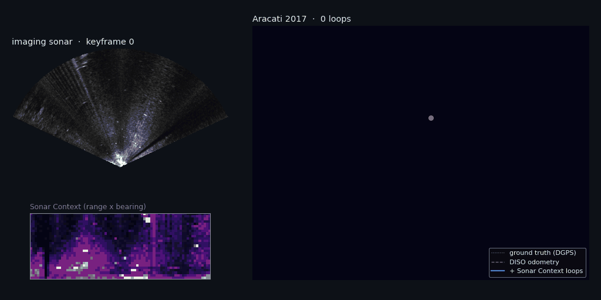
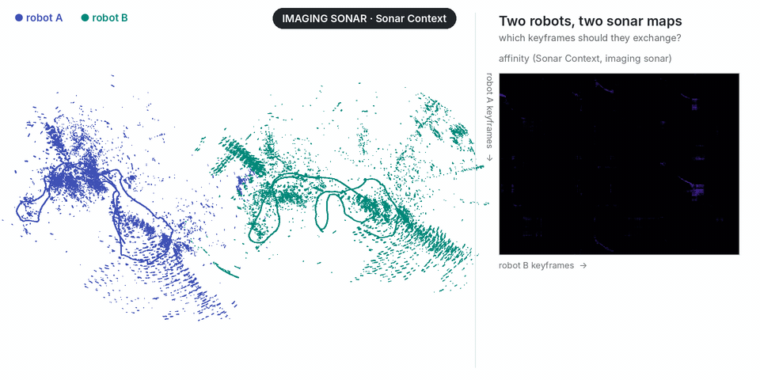

<div align="center">
  <h1>Sonar Context</h1>
  <a href="https://github.com/sparolab/sonar_context/tree/main/python"></a>
  <a href="https://pypi.org/project/sonar-context/"></a>
  <a href="#c"></a>
  <a href="#slam"></a>
  <a href="#slam"></a>
  <a href="#slam"></a>
  <a href="https://github.com/sparolab/sonar_context/actions/workflows/ci.yml"></a>
  <a href="https://sites.google.com/view/sonar-context"></a>
  <a href="https://ieeexplore.ieee.org/document/10161518"></a>
  <a href="https://www.youtube.com/watch?v=JRD_xuqtHZU"></a>
  <a href="https://github.com/sparolab/Commerge"></a>
  <br />
  <a href="https://pypi.org/project/sonar-context/"></a>
  <br />
  
  <p>
    <strong>[ICRA 2023] Robust Imaging Sonar-based Place Recognition and Localization in Underwater Environments</strong><br />
    Hogyun Kim, Gilhwan Kang, Seokhwan Jeong, Seungjun Ma, Younggun Cho · <a href="https://sites.google.com/view/sparo">SPARO Lab</a>, Inha University
  </p>
</div>

______________________________________________________________________

Underwater there is no GPS and no light; a forward-looking imaging sonar sees 50 m ahead through murky water, but its images are noisy, low-resolution and change with the viewpoint. **Sonar Context** turns one sonar image into a small, robust place descriptor, so a robot can tell that it has been here before.

- :ocean: **Sonar Context**: the polar sonar image pooled into patches (range rings × bearing sectors), plus a **polar key** (one value per range ring) that does not change with the heading.
- :mag: **Coarse to fine**: the polar key finds candidates in a k-d tree; the Sonar Context compares them column by column over every bearing shift (a rotation) and row by row (a motion along the beams).
- :repeat: **SLAM**: [DISO](https://github.com/SenseRoboticsLab/DISO) sonar odometry + Sonar Context loops, verified by dense phase correlation and optimized with iSAM2, on ROS 1 and ROS 2.
- :busts_in_silhouette: **Multi-session and multi-robot**: sessions recorded apart are aligned through their shared places; two robots merge their maps with [Commerge](https://github.com/sparolab/Commerge) from a few keyframes.
- :package: **Library first**: `pip install sonar-context` (NumPy), a C++17 library with the same results, and every application built on them.

## :newspaper: News

- **[Nov 2026]** v2.0.0: Python and C++ libraries, SLAM with DISO (ROS 1 / ROS 2), multi-session SLAM, multi-robot SLAM with Commerge, and fixes to the matching (below). The ICRA 2023 code is kept at [v1.0.0](https://github.com/sparolab/sonar_context/tree/v1.0.0).
- **[Jan 2023]** Sonar Context is accepted to ICRA 2023.

## :hammer_and_wrench: Installation

```bash
pip install sonar-context                 # Python 3.9+, NumPy / SciPy / Pillow
git clone --recursive https://github.com/sparolab/sonar_context.git   # C++, SLAM (DISO as a submodule)
```

### Python

```python
import sonar_context as sc

# a polar sonar image: rows = range bins, columns = beams (layout="beam_range" if stored the other way)
desc = sc.sonar_context(image, patch=(4, 4))
dist, shift = sc.column_distance(desc_a, desc_b)        # 1 - similarity, best bearing shift (a rotation)

m = sc.SonarContextManager(col_threshold=0.2, exclude_recent=30)
for image in sequence:
    loop = m.update(image)                               # Loop(query, match, distance, column_shift, ...) or None
```

```bash
sonar-context describe polar_image.zip --layout beam_range --out seq.npz      # descriptors of a sequence
sonar-context loops seq.npz --out loops.csv --poses poses.txt               # online loop detection (+ precision)
sonar-context affinity a.npz b.npz --out affinity.npy                       # two sessions, for Commerge
```

### C++

```bash
sudo apt install libeigen3-dev
cmake -S cpp -B cpp/build && cmake --build cpp/build -j && ctest --test-dir cpp/build
```

```cpp
#include "sonar_context/sonar_context.hpp"
auto d = sonar_context::make_sonar_context(image);                 // CMake: sonar_context::sonar_context
auto m = sonar_context::column_distance(d_a, d_b);                 // m.distance, m.shift
```

Same distances and shifts as Python (checked in `python/tests/test_cpp.py`).

## :world_map: SLAM

[`applications/slam`](applications/slam): any odometry (default [DISO](https://github.com/SenseRoboticsLab/DISO), direct imaging sonar odometry, ICRA 2024) gives keyframes every 1 m; Sonar Context proposes revisits; each is verified by **dense phase correlation** of the two sonar frames (rotation searched, normalized peak ≥ 0.10) and closed with iSAM2. The core is ROS-free; the nodes are thin wrappers.

```bash
docker build -f docker/Dockerfile.slam -t sonar-context-slam:noetic .            # ROS 1: DISO + SLAM
docker run --rm -v <Aracati>:/data:ro -v $PWD/out:/out sonar-context-slam:noetic \
    roslaunch sonar_context_slam aracati2017.launch bag:=/data/ARACATI_2017_8bits_full.bag save_dir:=/out/slam \
    record:=/out/aracati_diso.bag                                                # + a bag for ROS 2
docker build -f docker/Dockerfile.slam-ros2 -t sonar-context-slam:humble .       # ROS 2: SLAM on recorded poses
docker run --rm -v $PWD/out:/out sonar-context-slam:humble \
    ros2 launch sonar_context_slam aracati2017.launch.py bag:=/out/aracati_diso_ros2 save_dir:=/out/slam_ros2
```

On **Aracati 2017** (44 min, 620 m in a marina, BlueView P900-130), live with DISO, against the DGPS ground truth (`evo_ape -a`; scale-corrected `-as` in parentheses):

| | DISO odometry | **+ Sonar Context loops** | loops |
| --- | --- | --- | --- |
| ROS 1 (DISO live) | 4.54 m (4.16 m) | **1.91 m (1.35 m)** | 40 |
| ROS 2 (DISO poses recorded by ROS 1) | 5.08 m | **1.81 m** | 40 |

DISO is not deterministic from run to run (4.5 to 5.1 m here); the loops bring every run under 2 m. DISO's poses are in a z-down frame (`flip_frame: true` turns them, and the sonar beams, to z-up). Everything else: [applications/slam](applications/slam).

## :busts_in_silhouette: Multi-session SLAM

[`applications/multi-session-slam`](applications/multi-session-slam): two sessions saved by the SLAM, each in its own frame, are aligned through inter-session Sonar Context loops (dense correlation, then the largest set that agrees on one transform) and optimized in one pose graph.

```bash
sonar_context_align_sessions session_a/ session_b/ merged/ --threshold 0.25
```

Aracati 2017 split in two sessions: 47 inter-session loops, 37 agree on one transform; the two sessions together come to **2.51 m** APE (17.88 m with session B left in its own frame; 1.96 m and 2.33 m for each session alone).

## :robot: Multi-robot SLAM with Commerge

[`applications/multi-robot-slam`](applications/multi-robot-slam): two robots merge their maps by exchanging only a few keyframes, chosen by [Commerge](https://github.com/sparolab/Commerge) (IJRR 2026) from the Sonar Context affinity between them: on Aracati split into two robots, 4.5 % of the keyframes (2.6 KB of poses) merge the maps within 1.3 m.

<p align="center"></p>

## :wrench: What changed in v2.0.0

The matching of the ICRA 2023 code had bugs, fixed in both libraries (the old code: [v1.0.0](https://github.com/sparolab/sonar_context/tree/v1.0.0)):

- the best bearing shift was read one entry off (`argmax + 1`), and could index past the array;
- shift 0 (the same heading) was never tested;
- the row search compared unshifted rows, so it had no effect;
- a shift with no non-empty overlap divided by zero.

New: `skip_range` drops the bright near field (on Aracati, 5 m), the polar image layout is explicit (`range_beam` / `beam_range`: Aracati's polar images are stored beams × range), and the descriptors of two sessions compare in one call (`column_similarity_matrix`, FFT-based).

## :card_file_box: Datasets

- **[Aracati 2017](https://github.com/matheusbg8/aracati2017)**: the bag (`/son`, `/pose_gt`) and the polar images; DISO's [Aracati2017_DISO](https://github.com/SenseRoboticsLab/Aracati2017_DISO) adds the dead-reckoning prior (`thirdparty/`).
- **[HoloOcean](https://holoocean.readthedocs.io/)** simulation: [Google Drive](https://drive.google.com/drive/folders/1tPEZzdvOCRTILfkeq2X0KLuOM3v53kQL?usp=sharing).
- KRISO (Korea Research Institute of Ships and Ocean Engineering): not public.

## Citation

<details>
  <summary><strong>See bibtex</strong></summary>

```bibtex
@inproceedings{kim2023robust,
  title={Robust Imaging Sonar-based Place Recognition and Localization in Underwater Environments},
  author={Kim, Hogyun and Kang, Gilhwan and Jeong, Seokhwan and Ma, Seungjun and Cho, Younggun},
  booktitle={2023 IEEE International Conference on Robotics and Automation (ICRA)},
  pages={1083--1089},
  year={2023},
  organization={IEEE}
}
```

</details>

## Acknowledgements

Sonar Context builds on [Scan Context](https://github.com/gisbi-kim/scancontext) (Kim and Kim, IROS 2018). The SLAM uses [DISO](https://github.com/SenseRoboticsLab/DISO) (Xu et al., ICRA 2024, GPLv3, a submodule) for odometry and [GTSAM](https://github.com/borglab/gtsam). Data: [Aracati 2017](https://github.com/matheusbg8/aracati2017) (dos Santos et al., RA-L 2022), [HoloOcean](https://github.com/byu-holoocean/HoloOcean) (Potokar et al., ICRA 2022); multi-session underwater SLAM: Jang et al., ICRA 2021. Related: [SOLiD](https://github.com/sparolab/SOLiD), [Commerge](https://github.com/sparolab/Commerge), [ReFeree](https://github.com/sparolab/ReFeree), [RadLoc](https://github.com/sparolab/RadLoc).

## License

BSD 3-Clause for academic use; for any commercial purpose, please contact the authors (hg.kim@inha.edu). DISO (`thirdparty/DISO`) is GPLv3 and is not part of this license.
