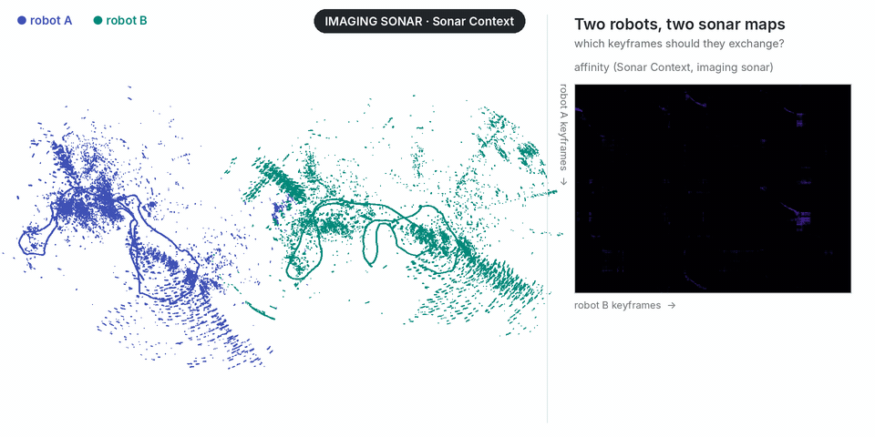

# Multi-robot SLAM with Commerge

<p align="center"></p>

Two robots map the same harbour without seeing each other; to merge their maps they must exchange data over a slow acoustic or radio link. [Commerge](https://github.com/sparolab/Commerge) (IJRR 2026) picks the few keyframes that carry the overlap from the affinity of the robots' place descriptors and merges the maps from those alone. Here the descriptor is Sonar Context.

Aracati 2017 split in two (robot A: first half, robot B: second half, keyframes every 1 m), robot B moved into its own frame (yaw 60°, (30, −20, 0) m):

```bash
pip install sonar-context commerge
python make_sessions.py --images <Aracati>/polar_image.zip --poses <Aracati>/pose_gt.txt --out runs/aracati
commerge runs/aracati/robot_a runs/aracati/robot_b --affinity runs/aracati/affinity.npy \
    --threshold 0.9 --min-area 50 --registration pairs --policy all --out runs/aracati/merged \
    --gt-a runs/aracati/robot_a/gt_poses.txt --gt-b runs/aracati/robot_b/gt_poses.txt
```

```
[commerge] registered B to A from 30 selected pairs: RMS 3.67 m; vs ground truth: 1.98 m, 3.03 deg (B keyframes 1.33 m off on average)
[commerge] exchanged 15 A + 12 B keyframes (4.5 % of 596, 2.6 KB of poses) from region(s) [0, 1, 2] of 3
```

The robots exchange 4.5 % of their keyframes, as poses only (2.6 KB), and robot B's map lands within 1.3 m of robot A's. `pose_gt.txt` is the bag's `/pose_gt` as text (`stamp bagtime x y z qx qy qz qw`); the affinity is `sonar_context.column_similarity_matrix` of the two robots' Sonar Contexts. More sensors with Commerge: [Commerge/tools/demo](https://github.com/sparolab/Commerge/tree/main/tools/demo).
